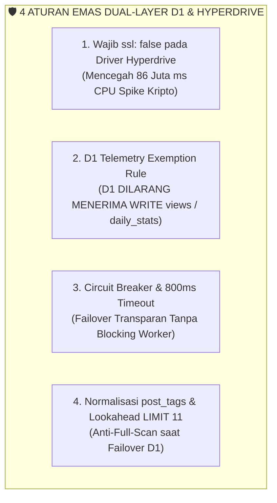

# 🛡️ STANDAR ARSITEKTUR DUAL-LAYER: CLOUDFLARE D1 & HYPERDRIVE MYSQL
## Panduan Penyelamatan Resource, Anti-Crypto CPU Spike, & Pencegahan Overquota untuk Seluruh Project Turunan CMSMu

**Status:** Living Document & Doktrin Arsitektur Mutlak  
**Otoritas:** `@db-architect`, `@infra-engineer`, & `@expert-developer`  
**Wajib Dipatuhi Oleh:** Seluruh Agen AI dan Software Engineers sebelum merancang atau mengimplementasikan integrasi dual-database (MySQL Hyperdrive & Cloudflare D1).  
**Referensi Historis:** Pelajaran Insiden Kebocoran Kuota Suara 'Aisyiyah (42 Miliar Rows Read & 86 Juta ms CPU).

---

## 1. Latar Belakang & Filosofi Arsitektur Dual-Layer

Banyak portal media berskala besar (seperti Suara 'Aisyiyah dan Newsroom) mengadopsi pola **Dual-Database Resilient Pattern**:
1. **Primary Layer:** Server MySQL VPS/Cloud (dihubungkan via Cloudflare Hyperdrive untuk *connection pooling* di edge).
2. **Fallback / Hot Standby Layer:** Cloudflare D1 Serverless Database (sebagai replika tepi jaringan jika VPS mengalami *downtime*).

> [!CAUTION]
> **PERINGATAN KRITIS:**  
> Pola Dual-Layer ini sangat ampuh memberikan *Zero Downtime*, **TETAPI** dapat menjadi bencana biaya jika tidak mematuhi 4 Aturan Emas (*The 4 Golden Invariants*). Kesalahan konfigurasi SSL atau kueri unindexed dapat seketika membakar puluhan juta baris D1 dan puluhan juta milidetik CPU Workers!

---

## 2. 4 Aturan Emas Arsitektur Dual-Layer (The 4 Golden Invariants)



### 1. Aturan 1: Wajib `ssl: false` pada Driver Koneksi Hyperdrive
* **Akar Masalah:** Driver `mysql2` secara default mencoba menegosiasikan SSL/TLS pada setiap koneksi baru. Di runtime Worker, komputasi kriptografi kunci asimetris (RSA/ECDHE) memakan **10–30 ms CPU per request**.
* **Fakta Teknis:** Cloudflare Hyperdrive berjalan sebagai proxy edge internal yang **sudah mengelola enkripsi TLS persisten ke database origin** di lapisan jaringannya.
* **Aturan Mutlak:** Koneksi lokal Worker ke Hyperdrive **WAJIB** disetel `ssl: false`:
  ```typescript
  import { createHyperdriveConfig } from "@cmsmu/db";

  // Gunakan factory resmi dari @cmsmu/db:
  const config = createHyperdriveConfig(c.env.HYPERDRIVE);
  // Menghasilkan { host, port, user, password, database, ssl: false, connectTimeout: 800 }
  ```

---

### 2. Aturan 2: Proteksi Mutlak Telemetri (D1 Telemetry Exemption Invariant)
* **Akar Masalah:** Men-dual-write penambahan view artikel (`SET views = views + 1`) atau rekap harian (`daily_stats`) ke D1 akan menghabiskan batas kuota tulis D1 (100.000 writes/hari) dalam waktu kurang dari 1 jam saat terjadi lonjakan trafik.
* **Aturan Mutlak:**
  1. Seluruh operasi penulisan telemetri **HANYA BOLEH DITULIS KE MYSQL** atau ditampung di RAM Isolate / Workers KV.
  2. **D1 DIHARAMKAN SECARA MUTLAK** menerima mutasi penulisan telemetri, bahkan saat MySQL sedang down atau Circuit Breaker terbuka!
  ```typescript
  import { isTelemetryMutation } from "@cmsmu/db";

  if (isTelemetryMutation(sqlQuery)) {
    if (!canUseMysql()) {
      // 🛡️ DROP SECARA AMAN: Jangan pernah fallback write telemetri ke D1!
      return { success: true, meta: { rows_written: 0 } };
    }
  }
  ```

---

### 3. Aturan 3: Circuit Breaker & 800ms Failover Timeout
* **Akar Masalah:** Jika koneksi MySQL ke VPS mengalami *stall* atau *packet drop*, thread Worker akan menggantung hingga batas CPU timeout, membuat seluruh halaman lambat atau error 524/504.
* **Aturan Mutlak:**
  - Setiap query MySQL wajib dibungkus batas waktu maksimal **800 ms**:
    `executeWithTimeout(pool.query(sql), 800)`
  - Jika terjadi 2 kali kegagalan berturut-turut, **Circuit Breaker beralih ke state `OPEN` selama 30 detik**, dan seluruh query baca data inti langsung dialihkan ke D1 tanpa membuang waktu mencoba menghubung ke MySQL.

---

### 4. Aturan 4: Normalisasi Tagar (`post_tags`) & Lookahead Pagination
* **Akar Masalah:** Ketika sistem beralih (failover) ke D1, kueri gaya VPS seperti `SELECT COUNT(*)` dan `WHERE tags LIKE '%aisyiyah%'` akan memaksa D1 memindai seluruh 14.000+ baris artikel secara linear (*full table scan*).
* **Aturan Mutlak:**
  1. Halaman publik **DILARANG** mengeksekusi `SELECT COUNT(*)`. Wajib menggunakan **Lookahead Pagination (`LIMIT 11`)**.
  2. Tagar wajib dinormalisasi menggunakan tabel relasi bawaan `@cmsmu/db`:
     ```typescript
     import { postTags } from "@cmsmu/db";
     // Kueri tag wajib join tabel post_tags yang memiliki indeks (tag_slug, created_at DESC)
     ```

---

## 3. Checklist Verifikasi Mandiri untuk Engineer & Subagent

Sebelum merilis fitur atau project baru yang menggunakan MySQL/Hyperdrive atau D1:
- [ ] Apakah seluruh inisialisasi koneksi Hyperdrive menggunakan `createHyperdriveConfig()` atau memuat `ssl: false`?
- [ ] Apakah kueri `SET views = views + 1` terisolasi dari D1?
- [ ] Apakah kueri tag menggunakan `post_tags` terindeks (bukan `LIKE '%...'`)?
- [ ] Apakah rute publik dilindungi Cloudflare Workers KV Cache?
- [ ] Apakah perintah `pnpm run check:dual-db` dan `pnpm run ci:check` lolos **0 Error**?
