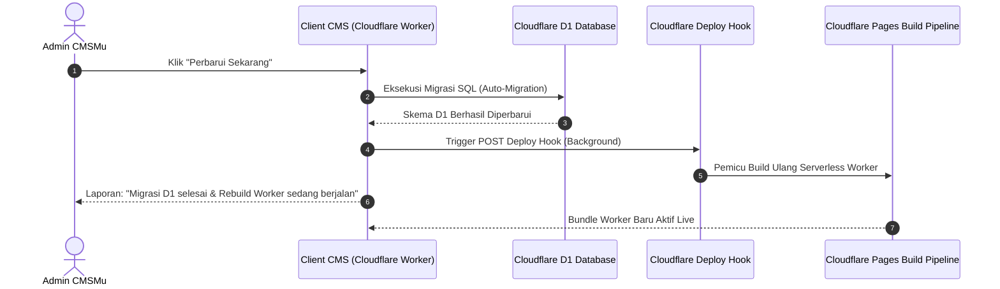

# 🚀 Panduan Setup Cloudflare Pages Deploy Hook untuk CMSMu OTA

Panduan praktis langkah demi langkah untuk mengonfigurasi **Cloudflare Pages Deploy Hook** pada CMSMu. Konfigurasi ini memungkinkan pembaruan sistem **100% otomatis** (Over-The-Air) yang memperbarui **Skema Database (Cloudflare D1)** sekaligus **Kode Serverless (Cloudflare Pages Worker)** secara seamless tanpa downtime.

---

## 📌 1. Latar Belakang & Konsep Arsitektur Hybrid

CMSMu berjalan di atas infrastruktur serverless **Cloudflare Pages / Workers**. Di lingkungan ini:
1. **Filesystem Isolate Bersifat Read-Only (Immutable):** Seluruh kode TypeScript, router backend API, modul admin, dan tema Astro dikompilasi menjadi satu bundle runtime `dist/_worker.js` saat build-time.
2. **Kebutuhan Hybrid Update:**
   - **Layer Database:** Dikelola langsung melalui migrasi SQL otomatis pada **Cloudflare D1**.
   - **Layer Serverless Code:** Membutuhkan kompilasi ulang (rebuild) bundle Worker pada **Cloudflare Pages** agar router, logic, dan tampilan terbaru aktif.

Dengan menghubungkan **Deploy Hook**, ketika Anda menekan tombol **"Perbarui Sekarang"** di Panel Admin CMSMu:
1. Sistem mengeksekusi migrasi skema database Cloudflare D1.
2. Sistem secara otomatis memicu webhook Deploy Hook Cloudflare Pages di latar belakang.
3. Cloudflare Pages melakukan rebuild & deployment Worker terbaru (selesai dalam 1–2 menit).
4. Instance CMSMu Anda resmi mutakhir 100%!



---

## 🛠️ 2. Langkah Demi Langkah Membuat Deploy Hook di Cloudflare

Ikuti langkah mudah berikut ini (hanya memakan waktu 2 menit):

### Langkah 1: Buka Cloudflare Dashboard
1. Masuk ke [Cloudflare Dashboard](https://dash.cloudflare.com).
2. Pada navigasi sebelah kiri, klik menu **Workers & Pages**.
3. Pilih proyek Cloudflare Pages tempat CMSMu Anda di-deploy.

### Langkah 2: Buka Pengaturan Deploy Hooks
1. Di halaman proyek Pages, klik tab **Settings** di bagian atas.
2. Di menu samping kiri, klik **Builds & deployments**.
3. Gulir ke bawah hingga Anda menemukan bagian **Deploy hooks**.

### Langkah 3: Tambahkan Deploy Hook Baru
1. Klik tombol **Add deploy hook**.
2. Masukkan informasi berikut:
   - **Deploy hook name:** Masukkan nama pengenal, misalnya: `cmsmu-ota-update`.
   - **Branch to build:** Pilih branch utama deployment Anda (biasanya `main` atau `master`).
3. Klik tombol **Add hook**.

### Langkah 4: Salin URL Webhook
Cloudflare akan menampilkan URL webhook unik, dengan format seperti berikut:
```text
https://api.cloudflare.com/client/v4/pages/projects/<nama-proyek>/deploy_hooks/<uuid-token>
```
Klik ikon **Copy** untuk menyalin URL tersebut ke clipboard Anda.

> [!WARNING]
> Simpan URL ini dengan aman. Siapa pun yang memiliki URL ini dapat memicu build ulang pada proyek Cloudflare Pages Anda.

---

## ⚙️ 3. Memasang Deploy Hook ke CMSMu

Setelah menyalin URL Deploy Hook, pasang ke instance CMSMu Anda:

1. Buka panel admin CMSMu Anda di `/admin/settings` atau buka tab **OTA Updater / OTA Manager**.
2. Gulir ke kartu **"Otomasi Pembaruan Serverless (Cloudflare Pages Deploy Hook)"**.
3. Tempelkan URL Deploy Hook yang telah Anda salin ke kolom input.
4. Klik tombol **Simpan Hook**.
5. Sistem akan menampilkan badge hijau: **"Terhubung (Otomatis 100%)"**.

---

## 🧪 4. Menguji Trigger Build

Untuk memastikan konfigurasi berfungsi dengan baik:

1. Di kartu yang sama, klik tombol **"Uji Trigger Build"**.
2. Panel admin akan mengirimkan request HTTP POST ke Cloudflare Pages.
3. Muncul notifikasi toast hijau: *"Sinyal Deploy Hook berhasil dikirim! Cloudflare Pages sedang melakukan proses build & deploy pembaruan kode terbaru di latar belakang."*
4. Anda dapat mengecek tab **Deployments** di dashboard Cloudflare Pages; build baru akan berstatus **Building** atau **Success**.

---

## 🔄 5. Otomasi Sinkronisasi Upstream (Opsional & Direkomendasikan)

Agar repositori Git Anda selalu memiliki rilis CMSMu terbaru dari upstream resmi (`cakipin/cmsMu-go`), Anda dapat mengaktifkan GitHub Actions terjadwal:

Buat berkas `.github/workflows/upstream-sync.yml` di repositori GitHub Anda:

```yaml
name: Upstream Sync

on:
  schedule:
    - cron: "0 2 * * *" # Berjalan otomatis setiap hari pukul 02:00 UTC
  workflow_dispatch: # Dapat dipicu manual kapan saja

jobs:
  sync:
    runs-on: ubuntu-latest
    steps:
      - name: Checkout Repository
        uses: actions/checkout@v4
        with:
          fetch-depth: 0

      - name: Sync Upstream Core
        run: |
          git config user.name "github-actions[bot]"
          git config user.email "github-actions[bot]@users.noreply.github.com"
          git remote add upstream https://github.com/cakipin/cmsMu-go.git || true
          git fetch upstream main
          git merge upstream/main --no-edit || echo "Silakan periksa konflik merge jika ada kustomisasi manual."
          git push origin main
```

Dengan alur ini, kode upstream terbaru akan otomatis masuk ke repositori Anda, dan ketika OTA dijalankan, Deploy Hook akan mengompilasi rilis terbaru tersebut!

---

## ❓ 6. Pertanyaan Umum (FAQ)

### Q: Apa yang terjadi jika saya belum memasang Deploy Hook?
**Jawab:** Sistem tetap aman! Ketika Anda menekan *Perbarui Sekarang*, skema database D1 akan berhasil dimigrasikan. Namun, kode Worker Cloudflare Pages tetap menjalankan versi lama sampai Anda melakukan push Git atau trigger deploy manual di Cloudflare Pages.

### Q: Apakah pembaruan ini akan menghapus data artikel atau media saya?
**Jawab:** **SAMA SEKALI TIDAK.** Seluruh artikel disimpan di database Cloudflare D1, dan berkas media disimpan di Cloudflare R2 bucket. Proses OTA hanya memperbarui skema kolom tabel D1 dan kode aplikasi.

### Q: Berapa lama waktu yang dibutuhkan setelah klik "Perbarui Sekarang"?
**Jawab:** Migrasi D1 selesai dalam waktu **1–2 detik**. Rebuild Worker oleh Cloudflare Pages biasanya memakan waktu **1–2 menit**. Setelah itu, refresh browser Anda (Ctrl+Shift+R / Cmd+Shift+R) untuk melihat fitur terbaru.
