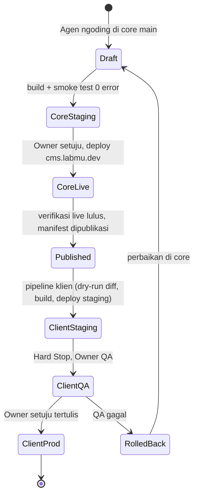

# Probis OTA Core CMSMu (Kesepakatan Alur Pembaruan)

> Status: **Disepakati v1** — 2026-10-05. Bagian 6 (keputusan terbuka) masih menunggu jawaban Owner; selama belum diputuskan, berlaku nilai default yang ditandai *(default sementara)*.

---

## 0. Fakta Teknis

| Jenis perubahan | Bisa OTA tanpa deploy ulang? | Alasan |
|---|---|---|
| Data / settings / manifest / konten | Ya | Tersimpan di D1 |
| Bundle JS admin (UI Alpine) | Ya (terbatas) | Disajikan dari D1 (`ota_bundles`) |
| Migrasi skema D1 (idempoten) | Ya | Dijalankan runner saat runtime |
| Kode server (router Hono, service, auth, render tema) | **Tidak** | Cloudflare Pages menjalankan bundle hasil build; wajib build + deploy |

"OTA" untuk kode server = **deploy otomatis yang dipicu Hub**, bukan kode berubah sendiri.

---

## 1. Aktor

| Aktor | Peran |
|---|---|
| Owner | Satu-satunya yang menyetujui rilis Core dan promosi Production klien |
| Agen AI | Ngoding di `core cmsMu` (branch `main`), build, smoke test, deploy Core Staging saja |
| Core Hub (`cms.labmu.dev`) | Sumber kebenaran: manifest versi, changelog, status rollout klien |
| Instansi Klien | Menerima update hanya lewat pipeline OTA; tidak boleh diubah manual |

---

## 2. Aturan Dasar (Invariants)

1. **Core selesai dulu, baru klien.** Klien tidak boleh menerima versi yang belum live dan terverifikasi di `cms.labmu.dev`.
2. **Satu versi, satu sumber.** `CORE_VERSION` (`ota.service.ts`) = `package.json` = tag git = manifest Hub. Tidak sama → rilis ditolak.
3. **Allowlist, bukan blacklist.** Sinkronisasi hanya menyalin file yang terdaftar di `core-manifest.json`. File di luar daftar = milik klien.
4. **Zona klien tidak dapat disentuh:** `src/cms/themes/*`, `src/themes/*`, `src/cms/addons/index.ts`, `src/cms/extensions/*`, addon klien, `public/`, `wrangler.*`, `.env`, dan file core yang dikustom klien.
5. **Deteksi drift wajib.** Hash file core di klien dibandingkan dengan versi core terakhir yang terpasang. Berbeda → file ditahan, dilaporkan, butuh keputusan Owner.
6. **Dilarang sinkron massal manual** dari laptop ke folder klien. Script sinkron hanya jalan di pipeline, selalu dry-run + laporan diff dulu.
7. **Hard Stop di setiap Staging** (Core dan klien). Production hanya dengan perintah tertulis Owner.
8. **Tanpa localStorage** untuk versi/status. Semua status dari D1/Hub.

---

## 3. Siklus Hidup Rilis

Status klien di Hub: `menunggu` → `staging` → `qa` → `production` / `gagal` / `rollback`, dilaporkan oleh pipeline/klien (bukan diisi manual).

---

## 4. Alur Langkah

### Tahap A – Core
1. Action Plan + daftar file → disetujui Owner.
2. Ngoding di `main`; naikkan versi di semua tempat sekaligus (aturan 2.2).
3. `npm run build` + smoke test → 0 error.
4. Deploy Core Staging → **HARD STOP**, URL ke Owner.
5. Owner setuju → deploy project `cmsmu` (`cms.labmu.dev`).
6. Verifikasi live: footer & `/api/addons/ota/status` menunjukkan versi baru; endpoint utama HTTP 200.
7. Push tag git + publikasi manifest di Hub (versi, changelog, daftar file core berubah, migrasi D1).

### Tahap B – Distribusi ke Klien
8. Hub menandai klien "update tersedia".
9. Owner/admin klien klik **Terapkan** → memicu pipeline klien.
10. Pipeline: ambil core sesuai tag → dry-run diff berbasis allowlist + cek drift → ada drift: **berhenti dan lapor** ke Hub.
11. Bersih: salin file allowlist → build → deploy Staging klien → lapor `staging` → **HARD STOP**.
12. Owner QA (tema, logo/favicon, rute khusus, login, register).
13. Owner setuju tertulis → promosi Production klien → lapor `production`.
14. Migrasi D1 berjalan otomatis (idempoten) saat versi baru pertama kali boot.

### Tahap C – Rollback
15. Klien gagal → rollback ke deployment Cloudflare sebelumnya, lapor `rollback`.
16. Perbaikan selalu di core, ulangi Tahap A dengan versi patch baru. Dilarang menambal di klien.

---

## 5. Pekerjaan Teknis Lanjutan (masing-masing wajib Action Plan terpisah)

1. `core-manifest.json` (allowlist file core) + validasi kesamaan versi saat build.
2. Mode drift-check + dry-run report di `scripts/sync-core-to-client.mjs`; tolak eksekusi non-pipeline.
3. Template workflow GitHub Actions klien (`sync-core-ota.yml`) sesuai Tahap B.
4. Endpoint Hub untuk laporan status pipeline.

---

## 6. Keputusan Terbuka (menunggu Owner)

| No | Keputusan | Default sementara |
|---|---|---|
| 1 | Pemicu deploy klien: GitHub Actions per repo klien atau Cloudflare Deploy Hook | GitHub Actions |
| 2 | File core yang dikustom klien: pindah ke `src/cms/extensions/` klien atau kunci permanen milik klien | Kunci sebagai milik klien (ditahan oleh drift-check) |
| 3 | Core Staging: project Cloudflare terpisah atau preview branch `cmsmu` | Preview branch `cmsmu` |
| 4 | Promosi Production klien: manual atau auto | Selalu manual oleh Owner |
