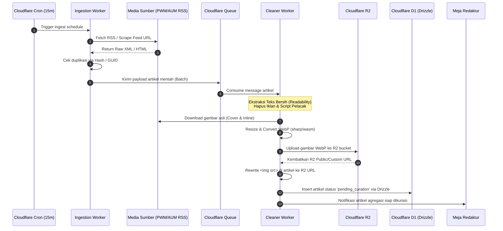
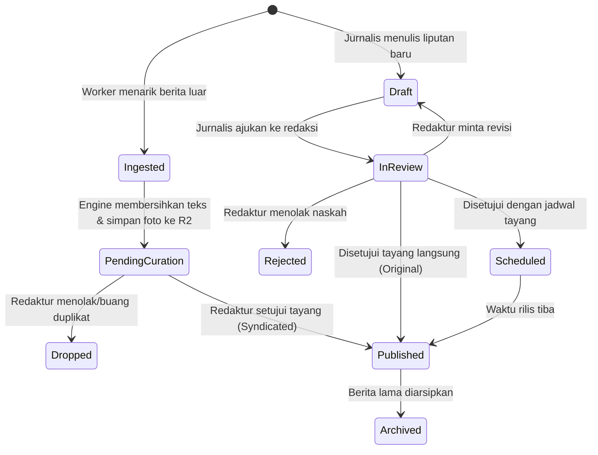
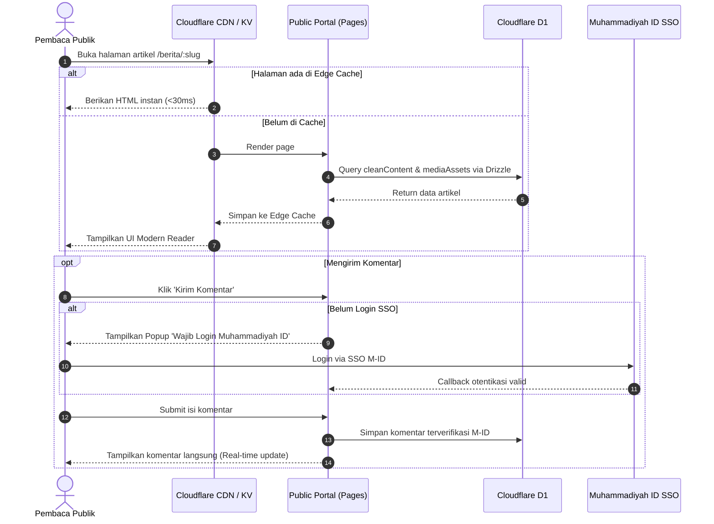
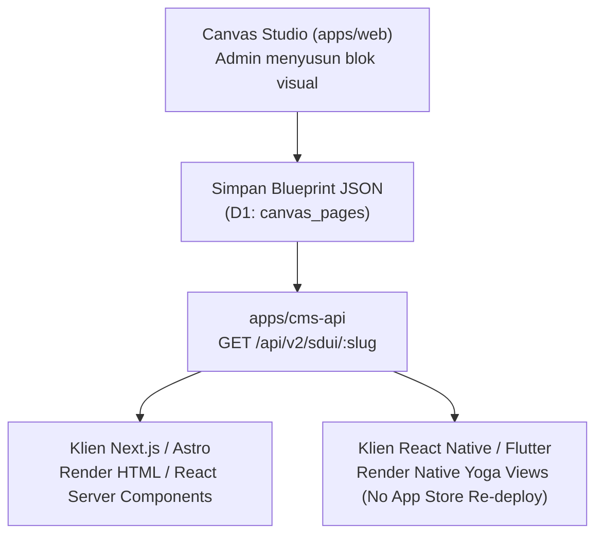

# Proses Bisnis, Workflow & Arsitektur Sistem (Cloudflare Native)
## Platform Newsroom & Media Aggregator Muhammadiyah

Dokumen ini mendefinisikan proses bisnis (*business process*), aktor, siklus hidup data, alur kerja (*workflow*), dan pemetaan arsitektur berbasis infrastruktur **Cloudflare Native** (Pages/Workers, D1, R2, Queues, KV, dan Cron Triggers).

---

## 1. Pemetaan Infrastruktur Cloudflare (Edge Native Architecture)

Sistem ini didesain 100% *serverless* di jaringan edge global Cloudflare untuk performa tinggi, biaya operasional ultra-rendah, dan tanpa beban pemeliharaan server fisik (*zero DevOps overhead*):

```
                               ┌────────────────────────────────────────┐
                               │           CLOUDFLARE EDGE CDN          │
                               │  - WAF / Anti-DDoS / SSL TLS 1.3       │
                               │  - Edge Cache (HTML & Static Assets)   │
                               └──────────────────┬─────────────────────┘
                                                  │
                                                  ▼
                        ┌─────────────────────────────────────────────────────┐
                        │        CLOUDFLARE PAGES / WORKERS (Next.js/Hono)    │
                        │  - Public Portal Reader (SSR / ISR)                 │
                        │  - Newsroom CMS Admin (Auth SSO Muhammadiyah ID)    │
                        │  - REST API Routes                                  │
                        └──┬─────────────────┬───────────────────┬────────────┘
                           │                 │                   │
           ┌───────────────▼────────┐ ┌──────▼────────────┐ ┌────▼──────────────┐
           │     CLOUDFLARE D1      │ │   CLOUDFLARE R2   │ │   CLOUDFLARE KV   │
           │   (Edge SQL Database)  │ │ (Object Storage)  │ │ (Fast Key-Value)  │
           │  - Drizzle ORM         │ │ - Clean Images    │ │ - Session Auth    │
           │  - Articles, Users,    │ │ - WebP Variants   │ │ - Feed ETags      │
           │    Taxonomies, Sources │ │ - Zero Egress Fee │ │ - Cache Ticker    │
           └────────────────────────┘ └───────────────────┘ └───────────────────┘
                           ▲                                      ▲
                           │               CLOUDFLARE QUEUES      │
                           │       ┌──────────────────────────────┴───────────────┐
                           └───────┤  Worker: Content Cleaner & Asset Sideloading │
                                   └──────────────────────────────▲───────────────┘
                                                                  │ Enqueue Tasks
                                   ┌──────────────────────────────┴───────────────┐
                                   │           CLOUDFLARE CRON TRIGGERS           │
                                   │  - RSS & Web Scraper Ingestion (Tiap 15 Menit)│
                                   └──────────────────────────────────────────────┘
```

### Komponen Infrastruktur Cloudflare:
1. **Compute (Aplikasi & API):** **Cloudflare Pages / Workers** menjalankan aplikasi full-stack (Next.js atau Hono + React) dengan latensi sub-50ms di seluruh Indonesia.
2. **Database:** **Cloudflare D1** (Serverless SQLite at the edge) dikelola menggunakan **Drizzle ORM** (`drizzle-orm/d1`).
3. **Penyimpanan Media (Gambar Hasil Sideload):** **Cloudflare R2** untuk menyimpan seluruh foto dan gambar hasil unduhan/kompresi WebP. Memiliki keunggulan **$0 egress fee** (tidak ada biaya bandwidth keluar).
4. **Pemrosesan Asinkron (Async Pipeline):** **Cloudflare Queues** menerima antrean artikel mentah hasil scraping untuk diproses (dibersihkan dan diunduh gambarnya) di latar belakang tanpa memblokir sistem utama.
5. **Penjadwalan Otomatis:** **Cloudflare Cron Triggers** mengeksekusi worker penarik berita (*ingestion worker*) secara berkala setiap 15 menit.
6. **Penyimpanan Nilai Kunci (Cache):** **Cloudflare KV** untuk caching ETag feed RSS, token sesi, dan breaking news ticker.

---

## 2. Proses Bisnis (Probis)

### 2.1 Aktor & Hak Akses (Role-Based Access Control)
1. **Super Admin:** Mengatur sumber feed media agregasi (PWM/PDM/AUM), master data majelis/ortom, dan izin pengguna.
2. **Pemimpin Redaksi (Editor in Chief):** Menentukan headline nasional, kurasi tingkat akhir, serta kebijakan sindikasi konten.
3. **Redaktur (Editor):** Memeriksa antrean artikel masuk, menyunting isi teks, mengoreksi SEO, dan menyetujui artikel orisinal maupun agregasi.
4. **Reporter / Jurnalis:** Menulis berita liputan mandiri, mengunggah foto, dan mengajukan artikel ke redaktur.
5. **Kontributor PWM/PDM/AUM:** Mengirim siaran pers atau rilis berita kegiatan daerah (wajib kurasi redaktur sebelum tayang).
6. **Pembaca Publik:** Mengakses portal berita, membaca artikel bersih, dan berkomentar (wajib login SSO Muhammadiyah ID).

### 2.2 Aturan Bisnis Utama (Invariants & Business Rules)
* **Aturan Etika Sindikasi Berita:** Berita hasil agregasi **wajib** mencantumkan media sumber asli, nama penulis asli, dan tautan *canonical URL* menuju artikel aslinya.
* **Aturan Kemandirian Media (Asset Isolation):** Seluruh gambar dari berita agregasi **dilarang keras** menggunakan tautan langsung (*hotlink*) ke server pihak ketiga. Seluruh gambar wajib diunduh, dioptimasi ke WebP, dan disajikan dari storage R2 sistem.
* **Aturan Kebersihan Konten (Zero-Ad Policy):** Seluruh skrip eksternal, iklan, widget pelacak, dan markup inline style dari media asal wajib dimusnahkan oleh *Cleaning Engine*.
* **Keamanan Komentar:** Hanya pengguna yang terverifikasi melalui SSO Muhammadiyah ID yang diizinkan mengirimkan komentar pada artikel.

---

## 3. Alur Kerja Sistem (Workflow)

### 3.1 Workflow Agregasi Berita & Asset Sideloading (Otomatis)



### 3.2 Workflow Meja Redaksi (Kurasi & Berita Orisinal)



### 3.3 Workflow Pembaca & Komentar (Public Portal)



---

## 4. Arsitektur Multi-Client, Server-Driven UI (SDUI) & Multi-Language (i18n)

### 4.1 Server-Driven UI (SDUI) Universal Workflow
Core cmsMu mendukung rendering multi-platform (*Astro SSR*, *Next.js App Router*, dan *React Native Mobile*) menggunakan satu sumber kebenaran blueprint JSON kanvas:



### 4.2 Multi-Language (i18n) & Fallback Cascade Matrix
Setiap entitas konten terikat pada `locales` (`id`, `en`, `ar`) dan dihubungkan oleh `translation_group_id`:
1. **Bahasa Indonesia (`id`, LTR)**: Bahasa dasar (*Canonical default*).
2. **Bahasa Inggris (`en`, LTR)**: Terjemahan internasional.
3. **Bahasa Arab (`ar`, RTL)**: Terjemahan keislaman / PCIM internasional dengan arah baca dwi-arah Kanan-ke-Kiri (*Right-to-Left*) dan font kaligrafi.

**Fallback Strategy**: Jika pengguna meminta `ar` atau `en` namun konten belum diterjemahkan, sistem secara otomatis (*zero crash*) menyajikan versi `id` disertai header informasi `X-CmsMu-Locale-Fallback: true`.

### 4.3 Arsitektur Implementasi Klien Next.js (`apps/nextjs-portal`)
1. **Pola Konsumsi SDK (`@cmsmu/sdk`)**: Next.js App Router menginisialisasi `createCmsMuClient({ baseUrl })` pada lapisan Server Component untuk menjaga performa rendering di sisi server (*React Server Components*).
2. **Dynamic Locale Routing (`/[locale]/...`)**: Parameter locale (`id`, `en`, `ar`) menentukan konfigurasi layout, metadata SEO, serta orientasi arah baca:
   - `id` & `en`: `<html lang="..." dir="ltr">` dengan font `Plus Jakarta Sans`.
   - `ar`: `<html lang="ar" dir="rtl">` dengan font `Amiri` dan alignment teks kanan-ke-kiri.
3. **Pola Render SDUI (`CmsMuBlockRenderer`)**: Menerima payload JSON dari `GET /api/theme-editor/sdui/:slug` dan memetakan array blok ke 8 komponen visual modular:
   - `SiteHeader`: Navigasi responsif, logo, menu dinamis, CTA, dan pemilih bahasa.
   - `Hero`: Header visual utama dengan headline, subheadline, dan tombol aksi.
   - `Partners`: Logo mitra kerja sama persyarikatan.
   - `FeatureGrid`: Grid fitur modular dengan ikon SVG kustom (tanpa emoji bawaan sistem).
   - `Testimonial`: Kartu kutipan ulasan dan profil narasumber.
   - `RecentPosts`: Daftar artikel warta terkini terintegrasi real-time via `client.posts.list()`.
   - `CallToAction`: Banner konversi dan ajakan bergabung.
   - `SiteFooter`: Navigasi kaki, hak cipta, dan jejaring sosial.

### 4.4 Arsitektur Implementasi Klien Mobile React Native (`apps/mobile-react-native`)
1. **Pola Server-Driven UI (Yoga Layout Engine)**:
   - Aplikasi mobile mengonsumsi `cmsMuClient.sdui.getPage('home', { platform: 'mobile', locale })`.
   - Komponen `NativeBlockRenderer` memetakan blok JSON ke komponen React Native: `View`, `Text`, `Image`, `ScrollView`, `TouchableOpacity`.
   - Perubahan tata letak kanvas di Web Studio langsung aktif di aplikasi ponsel tanpa perlu kompilasi ulang APK/AAB ke Google Play Store (*Zero Store Redeployment*).
2. **Kepatuhan Standar UI Mobile (SOP Aturan 9)**:
   - **SafeArea & System Insets**: Menggunakan safe bottom padding ($\ge 32\text{px}$) agar elemen tombol dan konten tidak tertutup oleh navigasi sistem Android (3-button / gesture bar).
   - **Pull-to-Refresh**: Seluruh layar dinamis (`HomeScreen`, `PostsScreen`) dibungkus `RefreshControl` bertema `#0a6134`.
3. **Multi-Language & RTL Mirroring**:
   - Mendukung bahasa Indonesia (`id`), Inggris (`en`), dan Arab (`ar`).

### 4.5 Ekosistem SDK Mobile Native Resmi (Flutter, Android Kotlin, Apple iOS Swift)
Untuk melayani pengembangan aplikasi mobile native lintas platform secara komprehensif, cmsMu menyediakan paket pustaka SDK resmi:
1. **Flutter & Dart SDK (`packages/sdk-flutter` - `cmsmu_sdk`)**:
   - Mendukung Flutter Mobile (Android & iOS) dan Web dengan Sound Null Safety.
   - Menyediakan `CmsMuClient` dengan method `sdui.getPage()`, `posts.list()`, dan `locales.list()`.
2. **Android Kotlin SDK (`packages/sdk-kotlin` - `dev.labmu.cmsmu.sdk`)**:
   - Mendukung Android API 24+ dan Jetpack Compose berbasis Kotlin Coroutines (`suspend fun`).
   - Data model `SDUIPage`, `SDUIBlock`, `PostItem`, dan `LocaleItem` siap konsumsi.
3. **Apple iOS Swift SDK (`packages/sdk-swift` - `CmsMuSDK`)**:
   - Mendukung iOS 15+, macOS 12+, dan SwiftUI dengan Swift Concurrency (`async/await`) berbasis SPM (*Swift Package Manager*).
   - Seluruh model mengadopsi protokol `Codable`, `Sendable`, dan `Identifiable`.

---

## 5. Batas Lingkup Repositori (Tenant Runtime vs Control Plane)

- **`cakipin/cmsMu-go` (Repositori Ini)**: Adalah **Tenant Runtime Instance** murni. Berfungsi sebagai basis website Cloudflare Pages + D1 + R2 + KV untuk pengguna/organisasi/sekolah. Mengelola konten berita, halaman statis, media, tema, dan panel admin tenant.
- **`core cmsMu` (Control Plane)**: Seluruh orkestrasi deployment Cloudflare (BYOC Deployer), kuota alokasi akun free/demo, verifikasi akun Git pengembang, dan pembuatan resource Cloudflare adalah kapabilitas eksklusif dari **Control Plane (`core cmsMu`)** di `cms.labmu.dev`. Modul BYOC sengaja tidak disertakan pada repositori ini demi menjaga isolasi keamanan, efisiensi ukuran bundle, dan pemisahan wewenang (*Separation of Concerns*).
