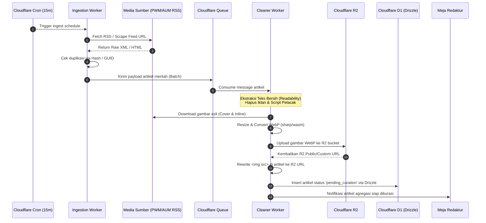
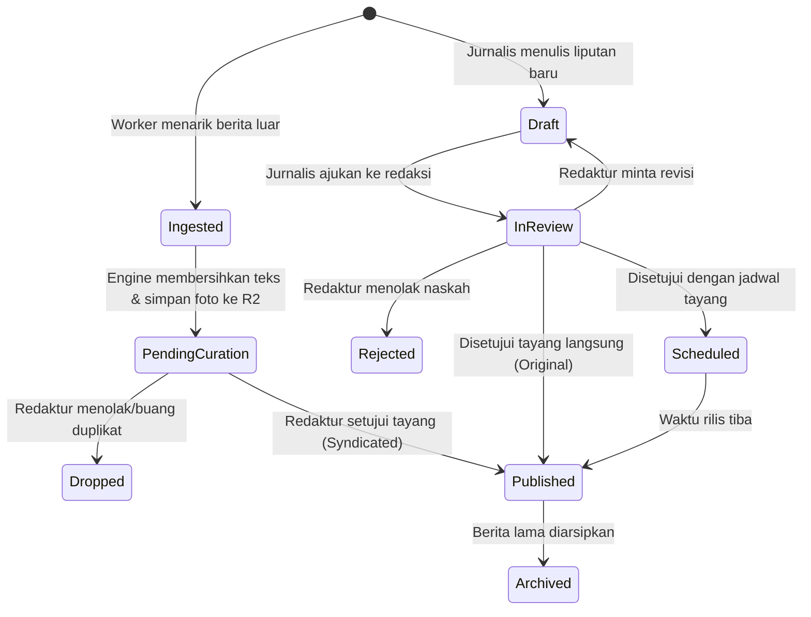
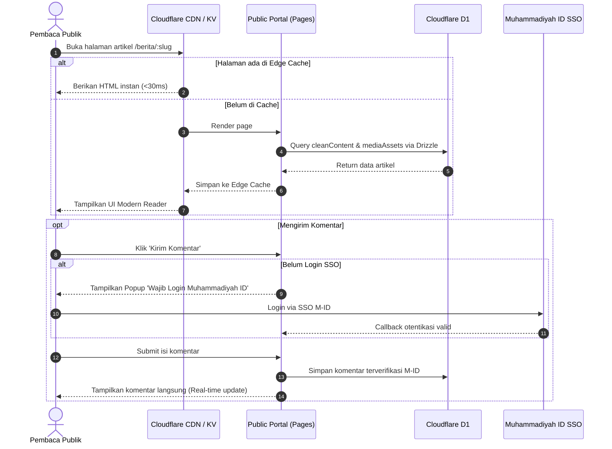

# Proses Bisnis, Workflow & Arsitektur Sistem (Cloudflare Native)
## Platform Newsroom & Media Aggregator Muhammadiyah

Dokumen ini mendefinisikan proses bisnis (*business process*), aktor, siklus hidup data, alur kerja (*workflow*), dan pemetaan arsitektur berbasis infrastruktur **Cloudflare Native** (Pages/Workers, D1, R2, Queues, KV, dan Cron Triggers).

---

## 1. Pemetaan Infrastruktur Cloudflare (Edge Native Architecture)

Sistem ini didesain 100% *serverless* di jaringan edge global Cloudflare untuk performa tinggi, biaya operasional ultra-rendah, dan tanpa beban pemeliharaan server fisik (*zero DevOps overhead*):

```
                               ┌────────────────────────────────────────┐
                               │           CLOUDFLARE EDGE CDN          │
                               │  - WAF / Anti-DDoS / SSL TLS 1.3       │
                               │  - Edge Cache (HTML & Static Assets)   │
                               └──────────────────┬─────────────────────┘
                                                  │
                                                  ▼
                        ┌─────────────────────────────────────────────────────┐
                        │        CLOUDFLARE PAGES / WORKERS (Next.js/Hono)    │
                        │  - Public Portal Reader (SSR / ISR)                 │
                        │  - Newsroom CMS Admin (Auth SSO Muhammadiyah ID)    │
                        │  - REST API Routes                                  │
                        └──┬─────────────────┬───────────────────┬────────────┘
                           │                 │                   │
           ┌───────────────▼────────┐ ┌──────▼────────────┐ ┌────▼──────────────┐
           │     CLOUDFLARE D1      │ │   CLOUDFLARE R2   │ │   CLOUDFLARE KV   │
           │   (Edge SQL Database)  │ │ (Object Storage)  │ │ (Fast Key-Value)  │
           │  - Drizzle ORM         │ │ - Clean Images    │ │ - Session Auth    │
           │  - Articles, Users,    │ │ - WebP Variants   │ │ - Feed ETags      │
           │    Taxonomies, Sources │ │ - Zero Egress Fee │ │ - Cache Ticker    │
           └────────────────────────┘ └───────────────────┘ └───────────────────┘
                           ▲                                      ▲
                           │               CLOUDFLARE QUEUES      │
                           │       ┌──────────────────────────────┴───────────────┐
                           └───────┤  Worker: Content Cleaner & Asset Sideloading │
                                   └──────────────────────────────▲───────────────┘
                                                                  │ Enqueue Tasks
                                   ┌──────────────────────────────┴───────────────┐
                                   │           CLOUDFLARE CRON TRIGGERS           │
                                   │  - RSS & Web Scraper Ingestion (Tiap 15 Menit)│
                                   └──────────────────────────────────────────────┘
```

### Komponen Infrastruktur Cloudflare:
1. **Compute (Aplikasi & API):** **Cloudflare Pages / Workers** menjalankan aplikasi full-stack (Next.js atau Hono + React) dengan latensi sub-50ms di seluruh Indonesia.
2. **Database:** **Cloudflare D1** (Serverless SQLite at the edge) dikelola menggunakan **Drizzle ORM** (`drizzle-orm/d1`).
3. **Penyimpanan Media (Gambar Hasil Sideload):** **Cloudflare R2** untuk menyimpan seluruh foto dan gambar hasil unduhan/kompresi WebP. Memiliki keunggulan **$0 egress fee** (tidak ada biaya bandwidth keluar).
4. **Pemrosesan Asinkron (Async Pipeline):** **Cloudflare Queues** menerima antrean artikel mentah hasil scraping untuk diproses (dibersihkan dan diunduh gambarnya) di latar belakang tanpa memblokir sistem utama.
5. **Penjadwalan Otomatis:** **Cloudflare Cron Triggers** mengeksekusi worker penarik berita (*ingestion worker*) secara berkala setiap 15 menit.
6. **Penyimpanan Nilai Kunci (Cache):** **Cloudflare KV** untuk caching ETag feed RSS, token sesi, dan breaking news ticker.

---

## 2. Proses Bisnis (Probis)

### 2.1 Aktor & Hak Akses (Role-Based Access Control)
1. **Super Admin:** Mengatur sumber feed media agregasi (PWM/PDM/AUM), master data majelis/ortom, dan izin pengguna.
2. **Pemimpin Redaksi (Editor in Chief):** Menentukan headline nasional, kurasi tingkat akhir, serta kebijakan sindikasi konten.
3. **Redaktur (Editor):** Memeriksa antrean artikel masuk, menyunting isi teks, mengoreksi SEO, dan menyetujui artikel orisinal maupun agregasi.
4. **Reporter / Jurnalis:** Menulis berita liputan mandiri, mengunggah foto, dan mengajukan artikel ke redaktur.
5. **Kontributor PWM/PDM/AUM:** Mengirim siaran pers atau rilis berita kegiatan daerah (wajib kurasi redaktur sebelum tayang).
6. **Pembaca Publik:** Mengakses portal berita, membaca artikel bersih, dan berkomentar (wajib login SSO Muhammadiyah ID).

### 2.2 Aturan Bisnis Utama (Invariants & Business Rules)
* **Aturan Etika Sindikasi Berita:** Berita hasil agregasi **wajib** mencantumkan media sumber asli, nama penulis asli, dan tautan *canonical URL* menuju artikel aslinya.
* **Aturan Kemandirian Media (Asset Isolation):** Seluruh gambar dari berita agregasi **dilarang keras** menggunakan tautan langsung (*hotlink*) ke server pihak ketiga. Seluruh gambar wajib diunduh, dioptimasi ke WebP, dan disajikan dari storage R2 sistem.
* **Aturan Kebersihan Konten (Zero-Ad Policy):** Seluruh skrip eksternal, iklan, widget pelacak, dan markup inline style dari media asal wajib dimusnahkan oleh *Cleaning Engine*.
* **Keamanan Komentar:** Hanya pengguna yang terverifikasi melalui SSO Muhammadiyah ID yang diizinkan mengirimkan komentar pada artikel.

---

## 3. Alur Kerja Sistem (Workflow)

### 3.1 Workflow Agregasi Berita & Asset Sideloading (Otomatis)



### 3.2 Workflow Meja Redaksi (Kurasi & Berita Orisinal)



### 3.3 Workflow Pembaca & Komentar (Public Portal)


