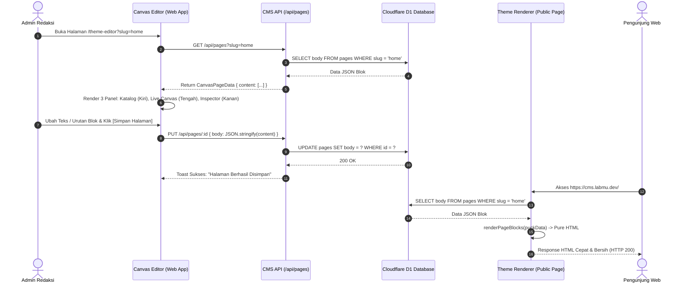

# 🏛️ ARSITEKTUR cmsMu NATIVE VISUAL BUILDER (CANVAS)
*Dokumentasi Teknis & Kontrak Data Sistem Visual Page Builder Bebas Ketergantungan Eksternal*

---

## 1. 🎯 Latar Belakang & Prinsip Desain

Arsitektur **cmsMu Native Visual Builder (Canvas)** dirancang untuk menggantikan pustaka pihak ketiga (`@puckeditor/core`) dengan sistem visual drag-and-drop mandiri yang:
1. **100% Zero External NPM Dependency**: Tidak lagi memerlukan runtime editor eksternal.
2. **100% Backward Data Compatibility**: Struktur JSON di database Cloudflare D1 (`pages.body` / `pages.puck_data`) tetap menggunakan skema standar yang sama.
3. **Ultra-Fast Server-Side Rendering (SSR)**: Merender HTML langsung di Cloudflare Workers/Pages tanpa komputasi berat.
4. **Patuhi Batasan Core Engine**: Seluruh modul dibangun dalam direktori `apps/cms-api/src/modules/theme-builder/` dan `apps/web/src/components/builder/`, tanpa menyentuh 20 file core yang terkunci di `core-lock.json`.

---

## 2. 🗄️ Skema Data JSON Kontrak (Data Contract)

Setiap halaman yang dibuat atau diedit oleh visual builder disimpan dalam format JSON terstruktur:

```typescript
export interface BlockItem<T = any> {
  type: string;       // Nama blok, contoh: 'SiteHeader', 'Hero', 'RecentPosts'
  props: T & {
    id: string;       // ID unik blok, contoh: 'Hero-1718000000'
  };
}

export interface CanvasPageData {
  content: BlockItem[];
  root: Record<string, any>;
  zones?: Record<string, BlockItem[]>;
}
```

### Kamus Komponen & Tipe Properti:
1. **`SiteHeader`**:
   - `siteTitle` (*string*), `logoImage` (*string*), `headerPosition` (*'fixed' | 'sticky' | 'static'*), `menuItems` (*array of {label, url}*), `showCta` (*'yes' | 'no'*), `ctaText`, `ctaUrl`.
2. **`HeroSlider`**:
   - `slides` (*array of {image, title, subtitle, buttonText, buttonLink}*), `sliderHeight` (*string*), `overlayOpacity` (*number*).
3. **`Hero`**:
   - `badgeText` (*string*), `title` (*string*), `titleHighlight` (*string*), `description` (*string*), `primaryButtonText`, `primaryButtonLink`, `backgroundImage` (*string*).
4. **`Partners`**:
   - `title` (*string*), `partners` (*array of {name, logoUrl, url}*).
5. **`FeatureGrid`**:
   - `title` (*string*), `description` (*string*), `features` (*array of {title, description, svgIcon}*).
6. **`Testimonial`**:
   - `title` (*string*), `testimonials` (*array of {quote, author, role, initials, bgColor}*).
7. **`RecentPosts`**:
   - `title` (*string*), `description` (*string*), `viewAllText` (*string*), `viewAllLink` (*string*), `postsCount` (*'3' | '6' | '9'*).
8. **`CallToAction`**:
   - `title` (*string*), `description` (*string*), `buttonText` (*string*), `buttonLink` (*string*), `footerText` (*string*).
9. **`SiteFooter`**:
   - `siteName` (*string*), `copyrightText` (*string*), `logoImage` (*string*).
10. **`CustomHTML`**:
    - `html` (*string*).
11. **`Spacer`**:
    - `height` (*number*).

---

## 3. 🔄 Alur Kerja Sistem (Sequence Diagram)



---

## 4. 🧩 Arsitektur 3 Panel Visual Builder UI

1. **Panel Kiri (Katalog Blok & Penata Urutan)**:
   - Menampilkan daftar blok yang dapat disisipkan.
   - Pohon susunan blok aktif (*Document Outline*) dengan fitur drag/reorder.
2. **Panel Tengah (Live Responsive Canvas)**:
   - Preview interaktif dengan simulasi viewport (*Desktop 100%*, *Tablet 768px*, *Mobile 375px*).
   - Indikator seleksi blok aktif dengan tombol cepat (*Move Up*, *Move Down*, *Duplicate*, *Delete*).
3. **Panel Kanan (Dynamic Property Inspector)**:
   - Form dinamis untuk mengedit teks, tautan, warna, dan gambar.
   - Terintegrasi dengan modal Media Manager internal cmsMu untuk memilih aset R2 tanpa input manual URL.
