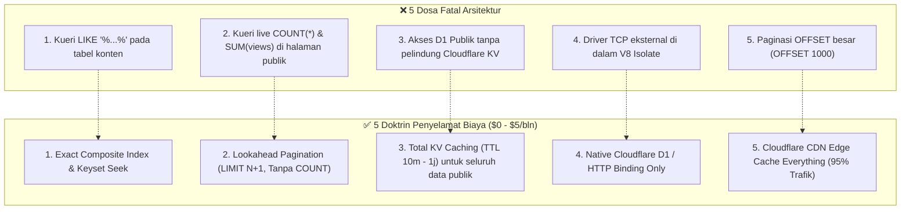
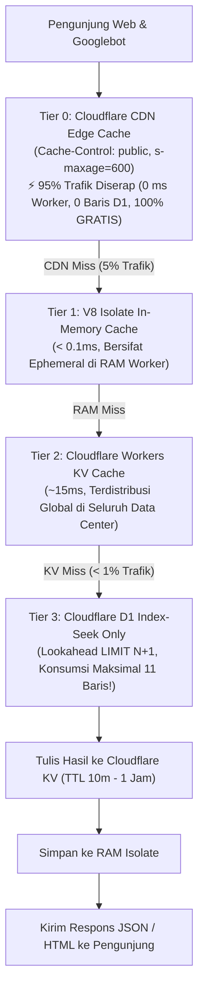
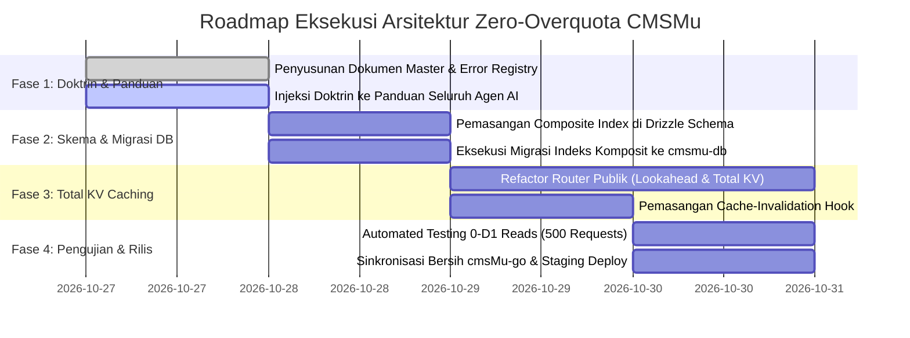

# 🛡️ DOKTRIN ARSITEKTUR ZERO-OVERQUOTA & ROADMAP EFISIENSI DATABASE
## Panduan Penyelamatan Resource Cloudflare D1 & Workers: Dari Bencana Menuju Keunggulan Biaya

**Status:** Living Document & Doktrin Arsitektur Mutlak  
**Otoritas:** `@db-architect`, `@system-analyst`, & `@expert-developer`  
**Wajib Dibaca Oleh:** Seluruh Agen AI & Software Engineers sebelum menyentuh kode database dan rute publik  
**Referensi Historis:** Pelajaran Insiden Kebocoran Kuota Suara 'Aisyiyah (42 Miliar Rows Read & 86 Juta ms CPU)  

---

## 1. Ringkasan Eksekutif & Refleksi Paradigma Serverless

### 1.1 Paradigma: Server Tradisional (VPS) vs Cloudflare Serverless

| Parameter | Server Tradisional (VPS / Dedicated) | Cloudflare Serverless (D1 & Workers) |
| :--- | :--- | :--- |
| **Model Biaya** | **Sewa Flat Bulanan** (misal \$10 - \$20/bulan) | **Pay-per-Resource** (Membayar baris yang dibaca & CPU time) |
| **Kuota Bawaan** | Bebas kueri sepuasnya sampai CPU 100% | **Gratis 5 Juta Baris Read per HARI** (150 Juta baris/bulan gratis) |
| **Dampak Kueri Buruk (`LIKE '%...'`)** | Server hanya sedikit lambat, biaya tetap flat \$10. | **Bencana:** Setiap kueri mencatat meteran baris yang dipindai (*full scan*). |
| **Connection Pooling** | Pool TCP dibuka 1x saat start dan dipakai terus. | Isolate hidup-mati dinamis (*ephemeral*), handshake TCP berulang memboroskan CPU. |
| **Potensi Biaya Riil** | \$10 - \$50/bulan flat | **\$0 s/d \$5/bulan** jika pola arsitekturnya benar! |

> [!CAUTION]
> **KESIMPULAN FUNDAMENTAL:**  
> Cloudflare Serverless **BUKAN INFRASTRUKTUR YANG MAHAL**, melainkan salah satu yang **PALING MURAH DI DUNIA** untuk portal media berskala jutaan pembaca. Kegagalan tagihan membengkak adalah **100% KESALAHAN ARSITEK/ENGINEER** yang membawa kebiasaan buruk koding VPS tradisional ke lingkungan serverless.

---

### 1.2 Studi Kasus: Mengapa Tagihan Suara 'Aisyiyah Sempat Jebol?

1. **Pemindaian Wildcard `LIKE '%...%'` pada 14.259 Artikel:**
   * Menulis kueri `SELECT count(*) WHERE tags LIKE '%aisyiyah%'` pada SQLite D1 mematikan fungsi B-Tree Index. Mesin D1 dipaksa memindai seluruh 14.259 baris secara linear.
   * Ketika Googlebot atau bot mesin pencari merayapi 5.000 tautan tag per hari:
     $$5.000\text{ request} \times 28.518\text{ baris dibaca} = \mathbf{142.590.000\text{ baris dibaca (142 Juta/hari)}}!$$
   * Inilah yang membakar **42 Miliar baris** dan menghancurkan kuota gratis 5 Juta/hari seketika.
2. **Handshake TCP MySQL di Runtime Serverless Workers:**
   * Memasang driver TCP MySQL memaksa runtime Worker melakukan negosiasi TLS 1.3 handshake dan otentikasi MySQL pada setiap klik pengunjung.
   * Hal ini membakar **86,2 Juta milidetik CPU Workers** secara percuma.
3. **Kueri Agregasi Live `COUNT(*)` dan `SUM(views)`:**
   * Menghitung total data di setiap kali pengunjung membuka halaman adalah anti-pattern nomor satu di database serverless.

---

## 2. Doktrin 5 Pantangan Mati Serverless D1 & Workers (The 5 Golden Invariants)

Setiap agen pengembang dan arsitek **DIHARAMKAN SECARA MUTLAK** melanggar 5 aturan ini:



### 1. Pantangan 1: Haram `LIKE '%...%'` pada Kolom Tanpa Full-Text Search
* **Bahaya:** Memaksa pemindaian seluruh isi tabel (*full table scan*).
* **Solusi Wajib:** Gunakan relasi tabel normalisasi atau pencocokan eksak menggunakan B-Tree Index. Kueri pencarian wajib dilindungi batas panjang input ($\ge 3$ karakter) dan disimpan di KV Cache selama 30 menit.

### 2. Pantangan 2: Haram Kueri Live `COUNT(*)` dan `SUM(views)` pada Halaman Publik
* **Bahaya:** Bot yang merayapi halaman 1 s/d halaman 500 akan memaksa database menghitung ulang jutaan baris data yang sama.
* **Solusi Wajib:** Gunakan **Lookahead Pagination (`LIMIT N+1`)**. Hilangkan angka total halaman kaku (*"Halaman 1 dari 1.425"*). Cukup tampilkan tombol *"Halaman Berikutnya"* jika data ke-$N+1$ ditemukan.

### 3. Pantangan 3: Haram Akses D1 Publik Tanpa Pelindung Cloudflare KV
* **Bahaya:** 10.000 pengunjung yang membaca artikel viral yang sama akan memicu 10.000 kali kueri ke D1.
* **Solusi Wajib:** Seluruh data publik (Home, Detail Post, Kategori, Tag, Menu) **WAJIB** dicek di memori RAM V8 Isolate ($< 0.1\text{ms}$) dan Cloudflare KV ($\sim 15\text{ms}$). D1 hanya boleh disentuh jika terjadi *Cache Miss* ($< 1\%$ dari total trafik).

### 4. Pantangan 4: Haram Membuka Driver TCP Database Eksternal di Serverless Worker
* **Bahaya:** Membakar jutaan milidetik kuota CPU Worker hanya untuk negosiasi SSL/TLS handshake berulang.
* **Solusi Wajib:** Wajib menggunakan **native Cloudflare D1 HTTP binding** (`env.DB`). D1 berjalan langsung di co-located edge node bersama Worker tanpa overhead jaringan eksternal.

### 5. Pantangan 5: Haram Paginasi Berbasis `OFFSET` Besar
* **Bahaya:** Kueri `OFFSET 5000 LIMIT 10` memaksa SQLite membaca 5.010 baris data lalu membuang 5.000 baris pertama.
* **Solusi Wajib:** Gunakan paginasi berbasis kursor (*Keyset Pagination*): `WHERE published_at < ? ORDER BY published_at DESC LIMIT 11`. Konsumsi baris dibaca **tetap konstan 11 baris**!

---

## 3. Proses Bisnis (Probis) Konsumsi Konten Publik Multi-Tier

Sistem konsumsi konten publik di CMSMu mengadopsi arsitektur piramida 4 lapis:



### Aturan Invalidation Cache Otomatis:
Ketika redaksi membuat, memperbarui, atau menghapus artikel di admin:
1. Event hook di Hono mengeksekusi `purgeKvCacheByPattern()` via `c.executionCtx.waitUntil()`.
2. Cache KV untuk detail artikel terkait (`cmsmu:pub:post:{slug}`) dan homepage (`cmsmu:pub:home`) dihapus.
3. Kunjungan berikutnya akan memicu 1 kali pembacaan D1 terindeks untuk membangun kembali cache KV baru (*Warm-up*).

---

## 4. Desain Indexing Komposit Strategis (D1 SQLite Schema)

Untuk memastikan bahwa 1% trafik yang menyentuh D1 hanya melakukan **B-Tree Index Seek** (bukan Full Scan), skema tabel `posts` dan entitas konten wajib dipasangi indeks komposit berikut:

```typescript
// packages/db/src/schema.ts

export const posts = sqliteTable("posts", {
  id: integer("id").primaryKey({ autoIncrement: true }),
  title: text("title").notNull(),
  slug: text("slug").notNull(),
  content: text("content"),
  category: text("category"),
  tags: text("tags"),
  status: text("status").default("draft"), // 'draft' | 'published' | 'archived'
  isFeatured: integer("is_featured").default(0),
  views: integer("views").default(0),
  publishedAt: text("published_at"),
  createdAt: text("created_at").default(sql\`CURRENT_TIMESTAMP\`),
  updatedAt: text("updated_at").default(sql\`CURRENT_TIMESTAMP\`),
}, (table) => ({
  // 1. Indeks Utama Feed Berita & Homepage (Wajib Index Seek: status + published_at)
  idxPostsPubFeed: index("idx_posts_pub_feed").on(table.status, table.publishedAt),
  
  // 2. Indeks Arsip Kategori Berita (Wajib Index Seek: category + status + published_at)
  idxPostsCatFeed: index("idx_posts_cat_feed").on(table.category, table.status, table.publishedAt),
  
  // 3. Indeks Headline / Hero Slider (Wajib Index Seek: isFeatured + status + published_at)
  idxPostsFeatFeed: index("idx_posts_feat_feed").on(table.isFeatured, table.status, table.publishedAt),
  
  // 4. Indeks Detail Artikel Berbasis Slug (Unique Seek)
  idxPostsSlug: uniqueIndex("idx_posts_slug").on(table.slug),
}));
```

### Hasil Analisis Cost Kueri:
* Kueri Homepage: `SELECT ... FROM posts WHERE status = 'published' ORDER BY published_at DESC LIMIT 11`
  * **Tanpa Indeks Komposit:** Memindai 14.259 baris disk.
  * **Dengan `idx_posts_pub_feed`:** Memindai **tepat 11 baris**! Penghematan: **99.92%**.

---

## 5. Algoritma Lookahead Pagination (Pengganti Mutlak `COUNT(*)`)

### Kode Standar Lookahead Pagination ($N+1$):
```typescript
export async function getPaginatedPosts(db: any, options: { page?: number; limit?: number; category?: string; beforeDate?: string }) {
  const limit = options.limit || 10;
  const fetchLimit = limit + 1; // Formula N + 1

  let query = db
    .select({
      id: posts.id,
      title: posts.title,
      slug: posts.slug,
      category: posts.category,
      publishedAt: posts.publishedAt,
      views: posts.views,
    })
    .from(posts)
    .where(
      options.category 
        ? and(eq(posts.status, "published"), eq(posts.category, options.category))
        : eq(posts.status, "published")
    )
    .orderBy(desc(posts.publishedAt))
    .limit(fetchLimit);

  if (options.beforeDate) {
    // Keyset pagination (jauh lebih hemat daripada OFFSET)
    query = query.where(lt(posts.publishedAt, options.beforeDate));
  }

  const rows = await query.all();
  const hasMore = rows.length > limit;
  const items = hasMore ? rows.slice(0, limit) : rows;

  return {
    items,
    pagination: {
      hasMore,
      nextCursor: hasMore ? items[items.length - 1].publishedAt : null,
      pageSize: limit,
      // ZERO COUNT QUERY: Tidak ada SELECT COUNT(*) yang membakar ribuan baris!
    }
  };
}
```

---

## 6. Roadmap 4 Fase Eksekusi & Pemantauan Kuota



1. **Fase 1 (Doktrin & Aturan):** Menanamkan aturan keramat ini ke `docs/ERROR_REGISTRY.md` dan berkas panduan seluruh agen spesialis di `.agents/agents/`.
2. **Fase 2 (Database Indexing):** Menambahkan 4 composite index strategis di `packages/db/src/schema.ts` dan mengeksekusi migrasi D1 di remote Cloudflare.
3. **Fase 3 (Total KV Router):** Membungkus seluruh endpoint publik di `apps/cms-api/src/modules/public/public.router.ts` dengan perlindungan KV Cache & Lookahead pagination.
4. **Fase 4 (Verifikasi & Rilis):** Menjalankan pengujian beban (*load test*) otomatis untuk memastikan 100% request publik berulang menghasilkan **0 D1 rows read**.
